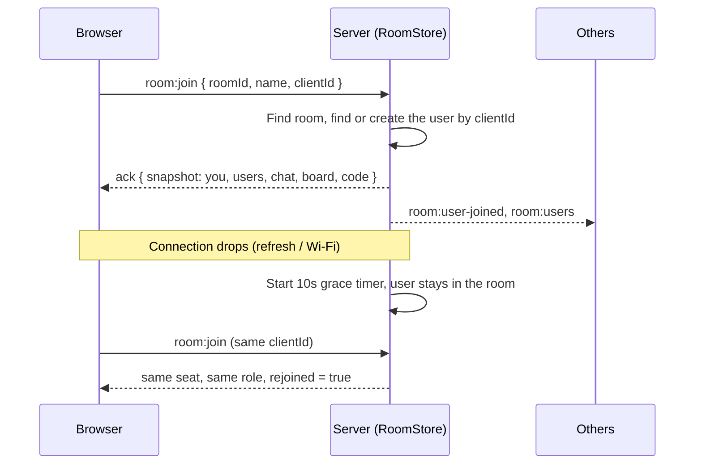
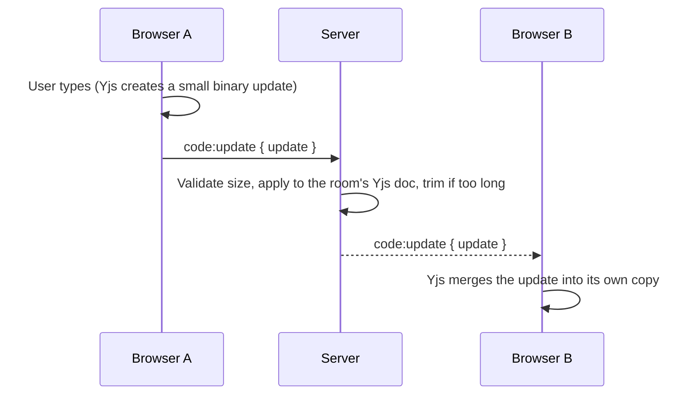
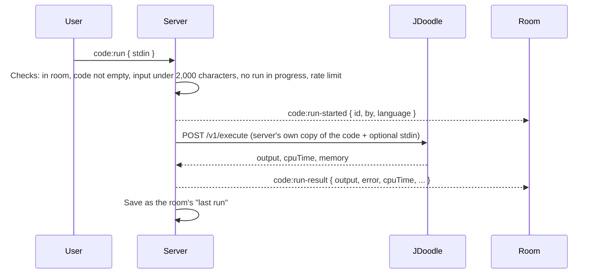
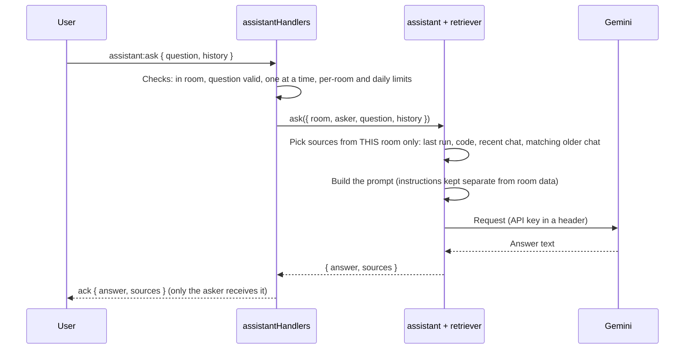

# CodeMate

**Draw, code and chat together in real time.**

**Live demo:** https://codemate-8q3l.onrender.com
(The first load can take up to a minute.)

CodeMate is a real-time collaboration workspace. People join a room with a 6-character code and work together on a shared whiteboard, a shared code editor with live cursors, one-click code execution, a room chat, and a private AI assistant, built with retrieval-augmented generation (RAG), that understands the room's code, chat and last run.

---

## Table of Contents

1. [Features](#features)
2. [Tech Stack](#tech-stack)
3. [How It Works (Workflow)](#how-it-works-workflow)
4. [Architecture](#architecture)
5. [Project Structure](#project-structure)
6. [Getting Started](#getting-started)
7. [Environment Variables](#environment-variables)
8. [Available Scripts](#available-scripts)
9. [API Reference](#api-reference)
10. [Real-time Events (Socket.IO)](#real-time-events-socketio)
11. [Limits and Safety](#limits-and-safety)
12. [Testing](#testing)
13. [Troubleshooting](#troubleshooting)
14. [Known Limitations](#known-limitations)
15. [Future Improvements](#future-improvements)
16. [License](#license)

---

## Features

### Rooms and presence
- Create a room in one click and share its 6-character code or invite link.
- Room codes avoid confusing characters (no `0`, `O`, `1`, `I`) so they are easy to read aloud.
- The first person in becomes the **host**. If the host leaves, the role passes to another connected member.
- A refresh or a short Wi-Fi drop keeps your seat (10-second grace period), so you rejoin as the same person.
- Live "joined" and "left" notifications and a people list with `You` and `Host` badges.
- Empty rooms are deleted automatically after 30 minutes.

### Whiteboard
- Pencil, line and rectangle tools, with colour and brush size.
- Strokes appear live for everyone while they are being drawn.
- Per-user **undo and redo**: you can only undo your own strokes, never someone else's.
- Live named cursors for every participant.
- Only the host can clear the whole board.
- The board is stored as vector elements (not an image), so it is sharp on any screen and a late joiner gets the full drawing.

### Shared code editor
- Monaco editor (the editor that powers VS Code) with syntax highlighting.
- Conflict-free real-time editing using **Yjs**: two people typing at the same moment never lose edits.
- Live remote cursors and selections with name tags.
- Languages: JavaScript, Python 3, C and C++. The language is shared by the whole room.
- Dark and light mode, and a resizable output panel (drag the bar between editor and output).

### Code execution
- Run the room's code with one click. Everyone in the room sees who ran it and the output.
- Programs that read input (`scanf`, `input()`, `cin`) work: type the values, one per line, in the **Input for your program** box before clicking Run.
- The server always runs its own copy of the code. The only thing taken from the browser is the optional program input.
- One run at a time per room, plus per-room and daily limits.
- Powered by the JDoodle Compiler API. The keys stay on the server.

### Chat
- Real-time room chat with message history for late joiners.
- "Is typing" indicator.
- Rate limiting against spam.

### AI assistant
- Powered by Google Gemini (free tier).
- Uses **Retrieval-Augmented Generation (RAG)**: it searches the room's live code, run output and chat for the parts that matter, then gives only those to the model.
- Answers questions about the room's code, the last run and the chat, for example "Why did the last run fail?" or "What did we decide about the database?".
- Answers go **only to the person who asked**.
- Follow-up questions work (the last 3 turns are remembered).
- Each answer shows which sources it used (code, last run, chat).
- Built-in protections: room isolation, prompt-injection defence, per-room and daily limits.

---

## Tech Stack

| Layer | Technology |
|---|---|
| Frontend | React 18, Vite 7, React Router 7, Bootstrap 5 |
| Editor | Monaco Editor, `@monaco-editor/react`, `y-monaco` |
| Real-time sync | Socket.IO 4, Yjs (CRDT), `y-protocols` (awareness) |
| Backend | Node.js (20 or newer), Express 5, Socket.IO, `cors`, `dotenv` |
| Code execution | JDoodle Compiler API |
| AI assistant | Google Gemini API (free tier) |
| Retrieval (RAG) | Custom BM25 keyword ranking over live room data, no vector database needed |
| Testing | Node's built-in test runner (`node --test`), `socket.io-client` |

---

## How It Works (Workflow)

### 1. User journey

```
Home page
  ├─ Enter your name
  ├─ "Create room"  → POST /api/rooms → get a 6-character code
  └─ "Join room"    → GET /api/rooms/:code (does it exist?)
          │
          ▼
Room page  (/room/:code)
  ├─ Socket connects, client sends "room:join"
  ├─ Server replies with a snapshot: users, chat, board, code, last run
  └─ Tabs and panels
        ├─ Whiteboard   ── draw, undo, redo, clear (host only)
        ├─ Code editor  ── type together, pick language, run code
        └─ Sidebar      ── people list, chat, AI assistant
```

### 2. Joining and rejoining



### 3. Real-time code editing



Every browser keeps its own copy of the document, and Yjs merges all changes, so simultaneous typing never overwrites anyone. If the file grows past the limit, the server trims it and sends the fix to everyone.

### 4. Running code



### 5. Asking the AI assistant



How the assistant chooses what to read:
- **Last run**: always included.
- **Code**: sent whole if it is under 6,000 characters, otherwise split into overlapping 30-line chunks and the best-matching chunks are chosen.
- **Chat**: the most recent 12 messages are always included, and older chat is searched for matches.
- **Ranking** uses BM25 keyword search with light stemming, so it needs no downloads and works offline.
- All content is trimmed to a 14,000-character budget.

### RAG pipeline

The assistant is a lightweight **Retrieval-Augmented Generation (RAG)** system. Instead of sending the whole room to the model, it retrieves only the relevant pieces first, so answers stay grounded in what is really in the room.

| RAG step | In CodeMate |
|---|---|
| Data source | The room's live code, last run output and chat history |
| Chunking | Chat is grouped into small message chunks, code into overlapping 30-line pieces (`retriever.js`) |
| Retrieval | BM25 keyword ranking with light stemming and stop-word removal (`rank()`) |
| Context selection | The best chunks are picked within a fixed character budget (`selectSources()` in `assistant.js`) |
| Augmentation | Chosen chunks are added to the prompt as labelled `<source id="S1">` blocks (`prompt.js`) |
| Generation | Gemini answers using only that context and cites sources like (S2) |
| Citations | The UI shows "Based on: S1 code, S2 last run" under each answer |

Why BM25 instead of embeddings: room data is small, changes constantly and is full of exact terms (function names, error messages), which keyword search handles well. It also needs no vector database, no extra API calls and no downloads, so it works offline and costs nothing. Because `rank(chunks, query)` is a single function, it can be replaced with embedding-based search later without touching the rest of the code.

---

## Architecture

```
┌─────────────────────────── Frontend (React + Vite) ───────────────────────────┐
│ HomePage · RoomPage · Whiteboard · CodeEditorPanel · ChatPanel · AssistantPanel │
│ RoomContext (connection + shared state)  ·  CodeSync (Yjs <-> Socket.IO)        │
└───────────────────────────────────┬─────────────────────────────────────────────┘
                                    │  Socket.IO (WebSocket) + REST
┌───────────────────────────────────▼─────────────────────────────────────────────┐
│                           Backend (Node + Express)                              │
│  app.js builds the server and wires the handlers:                               │
│   roomHandlers · chatHandlers · boardHandlers · codeHandlers · assistantHandlers│
│                                                                                 │
│  RoomStore (in memory)  →  Room { users, chat, Board, CodeSession }             │
└──────────────┬──────────────────────────────────────────────┬───────────────────┘
               │ HTTPS                                        │ HTTPS
        ┌──────▼──────┐                                ┌──────▼──────┐
        │   JDoodle   │  (runs the code)               │   Gemini    │  (answers)
        └─────────────┘                                └─────────────┘
```

Key design decisions:

- **The server is the single source of truth.** Chat messages, undo and redo, language changes and run results are confirmed by the server and then broadcast.
- **Two ids per user.** `clientId` is a secret random id kept in the browser (per tab, in `sessionStorage`) and never sent to other users. `user.id` is the public id shown to everyone.
- **Dependency injection.** The runner and the assistant are passed into `buildServer(config, deps)`, so tests use fakes and never call JDoodle or Gemini.
- **Swappable parts.** `RoomStore` is the only class that knows rooms live in memory, the runner is one function (switching to Judge0 or Piston means writing another), and the retriever has a simple `rank(chunks, query)` shape that a smarter search can replace.
- **Secrets stay on the server.** API keys are read from `.env`, never sent to the browser, and never included in error messages.

---

## Project Structure

```
CodeMate/
├── backend/
│   ├── scripts/
│   │   └── check-assistant.js      # Live check that Gemini works with your key
│   ├── src/
│   │   ├── assistant/
│   │   │   ├── assistant.js        # Chooses sources and asks the model
│   │   │   ├── assistantHandlers.js# Socket events, limits, validation
│   │   │   ├── geminiClient.js     # Gemini API client with safe error handling
│   │   │   ├── prompt.js           # System prompt and prompt builder
│   │   │   └── retriever.js        # BM25 search, chunking for chat and code
│   │   ├── board/
│   │   │   ├── board.js            # Whiteboard model (strokes, undo, redo)
│   │   │   └── boardHandlers.js
│   │   ├── chat/
│   │   │   └── chatHandlers.js
│   │   ├── code/
│   │   │   ├── codeHandlers.js
│   │   │   ├── codeSession.js      # Yjs document, language, run bookkeeping
│   │   │   ├── languages.js        # Supported languages and JDoodle mapping
│   │   │   └── runner.js           # JDoodle runner
│   │   ├── rooms/
│   │   │   ├── roomHandlers.js
│   │   │   └── roomStore.js        # In-memory rooms, users, host logic
│   │   ├── util/
│   │   │   ├── ack.js              # Standard error reply
│   │   │   └── rateLimit.js
│   │   ├── app.js                  # Builds the Express + Socket.IO server
│   │   ├── config.js               # All settings and limits
│   │   └── server.js               # Entry point
│   ├── test/                       # One test file per module
│   ├── testkit/helpers.js          # Test server and socket helpers
│   ├── .env.example
│   └── package.json
│
└── frontend/
    ├── src/
    │   ├── components/
    │   │   ├── AssistantPanel.jsx
    │   │   ├── CenteredMessage.jsx
    │   │   ├── ChatPanel.jsx
    │   │   ├── CodeEditorPanel.jsx
    │   │   ├── MonacoEditor.jsx
    │   │   ├── ThemeToggle.jsx
    │   │   ├── Toasts.jsx
    │   │   ├── UserList.jsx
    │   │   └── Whiteboard.jsx
    │   ├── context/RoomContext.jsx # Connection, join, users, snapshot
    │   ├── lib/                    # api, socket, codeSync, drawBoard, identity, ...
    │   ├── pages/                  # HomePage, RoomPage
    │   ├── App.jsx
    │   ├── main.jsx
    │   └── index.css
    ├── .env.example
    ├── index.html
    ├── vite.config.js
    └── package.json
```

---

## Getting Started

### Prerequisites

- **Node.js 20 or newer** (the backend uses `findLastIndex`, `Object.hasOwn` and the built-in `fetch`).
- A free **Gemini API key** from <https://aistudio.google.com/apikey> (for the assistant).
- A free **JDoodle** account with Compiler API keys from <https://www.jdoodle.com> (for running code).

The app still starts without these keys. The assistant and the Run button simply show a clear "not set up" message until you add them.

### 1. Clone and install

```bash
git clone https://github.com/MohdHuzaifa-07/CodeMate.git
cd CodeMate

cd backend
npm install

cd ../frontend
npm install
```

### 2. Configure the backend

```bash
cd backend
cp .env.example .env        # on Windows: copy .env.example .env
```

Open `backend/.env` and fill in your keys (see [Environment Variables](#environment-variables)).

### 3. Configure the frontend

Create `frontend/.env`:

```env
VITE_BACKEND_URL=http://localhost:5000
```

### 4. Start both servers

In one terminal:

```bash
cd backend
npm run dev
```

In a second terminal:

```bash
cd frontend
npm run dev
```

Open <http://localhost:5173>. To try collaboration, create a room, then open the invite link in a second browser window. Each tab counts as a different person.

> The frontend is locked to port **5173** (`strictPort`) because the backend only allows that origin by default.

### 5. Check that the assistant works (optional)

```bash
cd backend
npm run check-assistant
```

This makes real calls to Gemini with the key in `backend/.env` and prints whether each step worked.

---

## Environment Variables

### Backend (`backend/.env`)

| Variable | Required | Description |
|---|---|---|
| `PORT` | No | Server port. Default `5000`. |
| `ALLOWED_ORIGINS` | No | Comma-separated list of frontend origins allowed to connect. Default `http://localhost:5173`. |
| `JDOODLE_CLIENT_ID` | For running code | JDoodle Compiler API client id. |
| `JDOODLE_CLIENT_SECRET` | For running code | JDoodle Compiler API client secret. |
| `GEMINI_API_KEY` | For the assistant | Google AI Studio API key. |
| `ASSISTANT_MODEL` | No | Gemini model name. Default `gemini-3.5-flash-lite`. |
| `ASSISTANT_THINKING` | No | Thinking level. Default `low`. |

### Frontend (`frontend/.env`)

| Variable | Required | Description |
|---|---|---|
| `VITE_BACKEND_URL` | No | Where the backend runs. Default `http://localhost:5000`. |

> **Never commit `.env` files or paste real keys into chats or issues.** Both `.gitignore` files already exclude `.env`. Commit only `.env.example`.

After changing `.env`, **restart the backend**. It is only read at startup.

---

## Available Scripts

### Backend

| Command | What it does |
|---|---|
| `npm start` | Start the server. |
| `npm run dev` | Start with automatic restart on file changes. |
| `npm test` | Run all tests. |
| `npm run check-assistant` | Real call to Gemini to verify your key and setup. |

### Frontend

| Command | What it does |
|---|---|
| `npm run dev` | Start the Vite dev server on port 5173. |
| `npm run build` | Create a production build in `dist/`. |
| `npm run preview` | Preview the production build locally. |

---

## API Reference

| Method | Endpoint | Description | Response |
|---|---|---|---|
| `GET` | `/health` | Health check | `{ "ok": true }` |
| `POST` | `/api/rooms` | Create a room | `201 { "roomId": "K7M2QX" }`, or `503` if the server is full |
| `GET` | `/api/rooms/:roomId` | Does this room exist? | `{ "exists": true }` |

Socket acknowledgements follow one standard shape:

```json
{ "ok": true }
{ "ok": false, "error": { "code": "NOT_IN_ROOM", "message": "Join a room first" } }
```

---

## Real-time Events (Socket.IO)

### Rooms
| Event | Direction | Purpose |
|---|---|---|
| `room:join` | client → server | Join or rejoin with `{ roomId, name, clientId }`. Ack returns the snapshot. |
| `room:leave` | client → server | Leave immediately and give up your seat. |
| `room:users` | server → room | Updated list of people. |
| `room:user-joined` / `room:user-left` | server → room | Notifications. |

### Chat
| Event | Direction | Purpose |
|---|---|---|
| `chat:send` | client → server | Send a message. |
| `chat:message` | server → room | Delivered to everyone, including the sender. |
| `chat:typing` | both | "Is typing" indicator. |

### Whiteboard
| Event | Direction | Purpose |
|---|---|---|
| `board:begin` | client → server → others | Start a stroke. |
| `board:extend` | client → server → others | Add points to a stroke (no ack, sent many times a second). |
| `board:undo` / `board:redo` | client → server | Server confirms with `board:remove` / `board:add` to everyone. |
| `board:clear` | client → server | Host only. Broadcasts `board:cleared`. |
| `board:cursor` | both | Live cursors (volatile, can be dropped). |

### Code
| Event | Direction | Purpose |
|---|---|---|
| `code:update` | both | Binary Yjs update. |
| `code:awareness` | both | Cursor and selection info. |
| `code:language` | both | Change the shared language. |
| `code:run` | client → server | Run the room's code. Optional `{ stdin }` carries the program input. |
| `code:run-started` / `code:run-result` | server → room | Run progress and output. |

### Assistant
| Event | Direction | Purpose |
|---|---|---|
| `assistant:status` | client → server | Is the assistant set up? |
| `assistant:ask` | client → server | Ask a question with `{ question, history }`. The answer returns in the ack, only to the asker. |

---

## Limits and Safety

All limits live in `backend/src/config.js`.

| Area | Limit |
|---|---|
| Rooms | 500 rooms in memory; empty rooms deleted after 30 minutes |
| Reconnect grace period | 10 seconds |
| Names | 30 characters |
| Chat | 1,000 characters per message, 5 messages per 3 seconds per user, 200 messages kept per room |
| Whiteboard | 3,000 elements per room, 3,000 points per stroke, 150 events per second per user, board size 1600 × 900 |
| Code editor | 100,000 characters, 64 KB per update, 2 MB document cap |
| Code runs | 15-second timeout, program input up to 2,000 characters, 5 runs per room per minute, one at a time per room, daily cap (`maxRunsPerDay`) |
| Assistant | 500-character questions, 4 asks per room per minute, one at a time per person, daily cap (`maxAsksPerDay`), 30-second timeout |

Safety measures:

- **Validation everywhere.** Every socket event checks that the sender is in a room and that the payload is valid.
- **Ownership rules.** Users can only extend or undo their own strokes. Only the host can clear the board.
- **Room isolation.** The assistant only ever receives the room object it is given, so one room can never see another room's content (covered by a test).
- **Prompt-injection defence.** Room text is passed as data inside tagged blocks, tag characters are neutralised, and the system prompt tells the model to ignore instructions found in room content.
- **No leaks.** Error messages shown to users never contain API keys or raw provider responses. Details go to the server log only.
- **Plain-text answers.** Assistant answers are never treated as HTML on the frontend.
- **CORS** is restricted to `ALLOWED_ORIGINS`.

---

## Testing

```bash
cd backend
npm test
```

The suite uses Node's built-in test runner and covers every module:

- Unit tests: board, code session, retriever, prompt building, runner, Gemini client.
- Integration tests: a real server on a random port with real socket clients for rooms, chat, board, code and the assistant.
- The JDoodle runner and the Gemini client are replaced with fakes, so tests are fast and never use up your free quota.

---

## Troubleshooting

| Problem | Cause and fix |
|---|---|
| **"Code execution is not set up on this server"** | JDoodle keys are missing. Add `JDOODLE_CLIENT_ID` and `JDOODLE_CLIENT_SECRET` to `backend/.env` and restart the backend. |
| **"The code took too long to run"** but credits are used | The program is waiting for input that was not provided. Type the values it reads (one per line) in the **Input for your program** box before clicking Run. A program that reads more values than you typed also waits until the timeout. |
| **"Daily run limit reached"** | JDoodle's free plan allows about 20 runs per day. Set `maxRunsPerDay` in `config.js` below your allowance. |
| **"The assistant is not set up on this server"** | `GEMINI_API_KEY` is missing in `backend/.env`. Restart after adding it. |
| **Assistant says the key was rejected** | Check the key in Google AI Studio and that it was pasted without spaces. |
| **"The free assistant limit is used up for now"** | Gemini free-tier rate limit. Wait a minute, or try tomorrow. |
| **"Free tier is not available for this key"** | Your Google account or region does not have free-tier access. Enable billing in AI Studio or use another account. |
| **Frontend shows "Server unreachable"** | The backend is not running, or `VITE_BACKEND_URL` is wrong. |
| **Browser blocks requests (CORS error)** | Add your frontend address to `ALLOWED_ORIGINS` in `backend/.env`. |
| **Port 5173 already in use** | Close the other process. The frontend deliberately refuses to pick another port. |

---

## Known Limitations

- **In-memory storage.** Restarting the backend wipes all rooms and resets the daily counters.
- **Program input is per person.** The Input box belongs to whoever clicks Run. It is not shared with the rest of the room.
- **Assistant cannot see the whiteboard drawing**, only code, the last run and chat.
- **No per-IP limit on room creation.** Add one before exposing the server publicly.
- **Free-tier privacy.** Question text and room content sent to Gemini on the free tier may be used by Google. Tell users not to share private information in the room.
- **Free-tier quotas.** JDoodle and Gemini free plans have small daily limits.

---

## Future Improvements

- Share the program input box with the whole room.
- Semantic retrieval for the assistant using embeddings (for example Gemini embeddings) alongside or instead of BM25.
- Persistent storage (a database behind `RoomStore`) and room history.
- User accounts and private or password-protected rooms.
- More whiteboard tools: text, eraser, shapes, image export.
- Voice or video calling.
- More languages for the code runner.
- Per-IP rate limiting and deployment configuration (Docker, reverse proxy, HTTPS).

---

## License

This project is licensed under the [MIT License](LICENSE).

## Author

**Mohd Huzaifa**

- LinkedIn: [linkedin.com/in/mohd-huzaifa-9a3b392ab](https://www.linkedin.com/in/mohd-huzaifa-9a3b392ab)
- GitHub: [MohdHuzaifa-07](https://github.com/MohdHuzaifa-07)